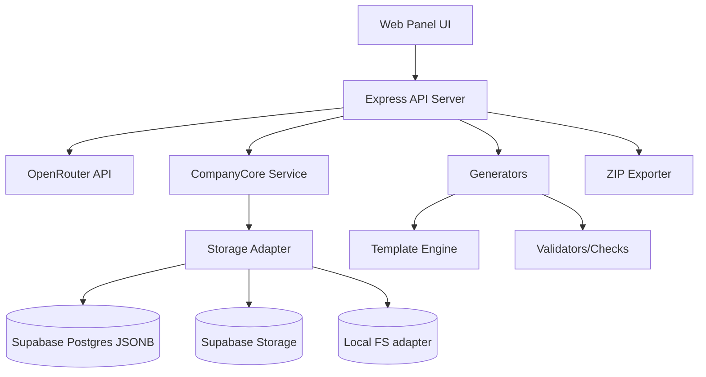

# Architecture

## 1. Goals
- Meet all FR/NFR from requirements
- Server-side only OpenRouter key management
- Deterministic fact source (company card JSON) for site generation
- Site versioning when card changes
- Static site export (ZIP)
- Extensible to 8 directions with shared facts
- Minimal complexity

## 2. Technology choices (proposed)

| Component | Choice | Rationale | Alternatives considered | Notes |
|-----------|--------|-----------|------------------------|-------|
| Runtime/Backend | Node.js + TypeScript + Express | Available (v24), simple, good for REST API, easy to integrate with OpenRouter HTTP API | Python/FastAPI, Go (not installed) | Minimal deps; easy to secure key server-side |
| Frontend | Vite + TypeScript | Fast dev, simple, can build static assets; easy to keep minimal | React/Vue/Svelte - more deps/complexity; vanilla fine for panel UI | Prefer simplest that meets needs |
| Storage (cloud) | **Supabase Postgres (JSONB) + Supabase Storage** | Reliable for Render/Railway, free tier available, JSONB fits canonical model, Storage for ZIPs | Render Disk (limited), files only (ephemeral) | Primary for deployment |
| Storage (local dev) | **File-based adapter** (JSON) | Easy local dev without external deps | SQLite | Swappable via storage interface |
| Templating (site gen) | Handlebars/EJS or simple string templates | For 3 pages, RU/DE, styling options - simple templating sufficient | Static site generators (11ty) - possible but adds complexity | Keep minimal; generate static HTML/CSS/JS files |
| ZIP export | `archiver` or `adm-zip` | Standard for packaging static site | Native zip if available | Upload to Storage or return to user |
| Validation | Zod | Type-safe schema validation for CompanyCore and modules | Ajv/jsonschema | Good with TS |

**Sources checked:** Node.js docs (general), Express docs patterns. No specific version constraints given in scope - use current compatible versions.

## 3. High-level architecture


### Components
- **API Server (server/):** Routes for company generation, site generation, library, config. Holds OpenRouter key in env/server config only.
- **Generators (server/generators/):** Company generator (calls OpenRouter with prompts), site generator (uses card facts + templates).
- **Validators (server/validators/):** FR-008 checks - cross-page consistency, phone/country, contradictions, i18n meaning, required fields, diversity.
- **Templates (server/templates/ or templates/):** HTML templates for 3 pages, RU/DE variants or i18n, styling/themes.
- **Storage (server/storage/):** CRUD for companies/sites/versions, JSON schema enforcement.
- **Frontend (client/):** Two-phase UI (A: company, B: site), library, preview, downloads.

## 4. Canonical Company Model (CompanyCore)

`CompanyCore` is the **single source of truth** for all generation. All modules read from it, none regenerate core facts.

```json
{
  "id": "uuid",
  "createdAt": "ISO8601",
  "updatedAt": "ISO8601",
  "inputs": { "brandName": "...", "country": "DE", "businessDirection": "...", "b2bServiceType": "...", "scale": "small|medium", "model": "..." },
  "identity": { "brandName": "...", "legalEntityName": "..." },
  "contacts": { "city": "...", "address": "...", "phone": "...", "email": "..." },
  "people": { "ceo": {"name": "...", "title": "...", "bio": "..."}, "heads": [{"name": "...", "title": "...", "bio": "..."}, {"name": "...", "title": "...", "bio": "..."}] },
  "business": { "history": "...", "specialization": "...", "targetAudience": "...", "clientProblem": "..." },
  "product": { "inputs": "...", "process": "...", "result": "...", "limits": "..." },
  "faq": [{"q": "...", "a": "..."}, {"q": "...", "a": "..."}, {"q": "...", "a": "..."}, {"q": "...", "a": "..."}, {"q": "...", "a": "..."}],
  "facts": { "factId": { "key": "...", "value": "...", "source": "core" } },
  "extensions": {},
  "meta": { "version": 1 }
}
```

### Fact Registry
Atoms facts (e.g. `legalEntityName`, `registeredAddress`, `contactPhone`) stored for cross-module validation.

### Module contract
- Modules may only read allowed fields from `CompanyCore`
- Must not regenerate `identity`, `contacts`, `people`
- Can add module-specific computed text/blocks
- Must store `snapshotHash` of `CompanyCore` at generation time

### Storage schema (Supabase)
- `companies_core` (id, core jsonb, facts jsonb, inputs jsonb, status, created_at, updated_at)
- `site_versions` (id, core_id, lang, style, storage_path, created_at)
- `company_modules` (id, core_id, module_key, payload jsonb, snapshot_hash, created_at) - for future 8 directions

## 5. Site structure and versioning
- Site generated from approved company card snapshot (facts frozen at generation time)
- Each generation creates new site version linked to companyId; old versions preserved
- Output: static files (HTML/CSS/JS/assets) packaged as ZIP
- No forms/server processing - static only
- nav, headings, metadata, favicon required

## 6. OpenRouter integration (security)
- API key read from server env/config only (e.g., `OPENROUTER_API_KEY`)
- Never sent to client, never written to generated site files, never logged
- **Model list:** Server proxies `GET https://openrouter.ai/api/v1/models`, caches 10-30 min, returns only `id/name/pricing/context_length` to client
- **Selection:** UI search/filter; whitelist fallback if API unavailable
- **Spend limit:** `OPENROUTER_SPEND_LIMIT_PER_OP_USD` in server config. Estimate cost before request using cached pricing; block if over limit. Track actual usage from response if available
- **Resiliency:** Error handling, limited retries (configurable)
- Saved results load without API calls
- All requests go through server proxy only

## 7. Consistency & diversity
- Single source of truth = `CompanyCore` (canonical)
- **Core snapshot** used for generation (immutable for that operation)
- **Cross-module validator** + **Joint validation** for multi-module sets
- **Fact Registry** ensures same facts used everywhere
- **Module contract** prevents core fact regeneration
- **Diversity:** vary history/specialization/team bios/target audience/product/FAQ - not just names/numbers
- Phone format should match country (DE patterns) - validate
- i18n: generate in RU/DE preserving meaning, facts unchanged

## 8. Extensibility (8 directions)
- Common fact store (company card) shared
- Modular generators/validators per direction
- Joint validation of final set
- Schema supports extension without breaking existing

## 9. Risks & mitigations
| Risk | Impact | Mitigation |
|------|--------|-----------|
| Stack unclear | Med | Chose minimal proven stack with justification |
| Key leakage | High | Server-only, env config, no client exposure, audit exports |
| Fact drift | High | Snapshot card at site gen, versioning, validators |
| Non-diverse companies | Med | Diversity checks, varied prompts, validation |
| Cost overrun | Med | Spend limit per operation, cost tracking |
| i18n meaning loss | Med | Facts frozen, translation carefully controlled |

## 10. Sources
- OpenRouter API docs (general patterns) - to be verified during impl; key handling best practices
- Express.js docs
- Vite docs
- No specific constraints found in scope requiring different stack
